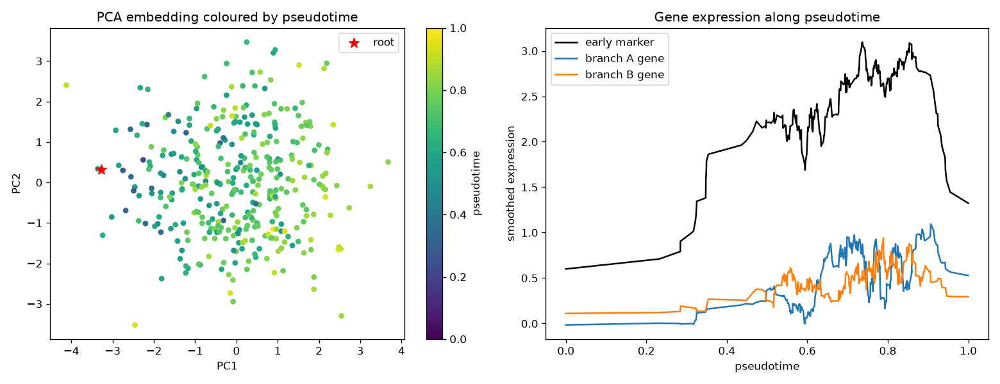

# Pseudotime Trajectory Inference

Cells do not switch fates like a light switch. They slide. Pseudotime is how we recover that sliding order from a snapshot of expression, pretending the single timepoint you sequenced actually contains a whole developmental movie.

This repo builds pseudotime from scratch using nothing but scikit-learn: a diffusion-style embedding, a root cell, and a principal curve that threads through the cloud of cells. No black-box trajectory tool. You see every step.

## Demo Output



The figure above was produced from simulated branching cell states by `demo.py` — a 2D embedding coloured by inferred pseudotime, plus gene-expression-versus-pseudotime curves.

## Why This Exists

Most people run a trajectory tool, get a pretty arrow, and never ask what the arrow means. The uncomfortable answer: pseudotime is a distance along a manifold, not a clock. If you understand how the ordering is computed, you stop over-interpreting it. That is the whole point of doing it by hand once.

## How It Works

1. Normalise and reduce expression with PCA.
2. Build a k-nearest-neighbour graph and take its shortest-path (geodesic) distances to approximate a diffusion-style ordering.
3. Pick a root cell (biologically, your most naive state).
4. Pseudotime = geodesic distance from the root.
5. Fit a principal curve by iteratively projecting cells onto a smoothed 1D ordering to visualise the backbone.
6. Plot genes against pseudotime to find what turns on and off along the path.

## Quick Start

```bash
pip install -r requirements.txt
python demo.py
python pseudotime.py --help
```

## Decision Framework

| Situation | Use pseudotime? | Why |
|-----------|-----------------|-----|
| Continuous differentiation captured in one sample | Yes | This is exactly the use case |
| Discrete, well-separated cell types | No | There is no trajectory to order |
| You have real timepoints | Maybe | Use them to validate, not replace, pseudotime |
| Heavy batch effects across samples | Fix batch first | Pseudotime will happily order your batches |

## When NOT to Use This

If your clusters are islands with no bridge of intermediate cells, a trajectory is a hallucination. Pseudotime will still draw a line between them, and that line is meaningless. Check for a connected manifold before you trust any ordering.

## The Uncomfortable Truth

Pseudotime is deeply sensitive to your root choice, your neighbourhood size, and your dimensionality reduction. Change any one and the ordering can flip. Treat it as a hypothesis-generator, not evidence. If a result only holds for one set of parameters, it is noise wearing a lab coat.

## Further Reading

- "Diffusion pseudotime robustly reconstructs lineage branching" by Laleh Haghverdi et al.
- "The dynamics and regulators of cell fate decisions are revealed by pseudotemporal ordering of single cells" by Cole Trapnell et al.
- "Principal Curves" by Trevor Hastie and Werner Stuetzle.
